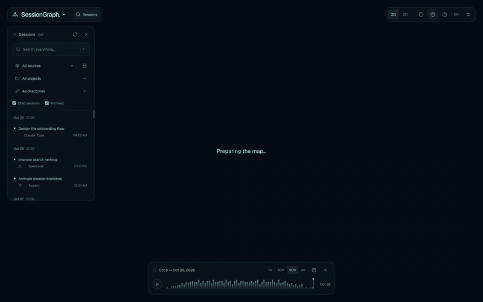

<h1 align="center">SessionGraph</h1>
<p align="center">Explore &amp; visualize all your LLM sessions</p>
<p align="center">
  <a href="https://github.com/arvindell/sessiongraph/releases/latest">Download</a> ·
  <a href="docs/guide.md">Documentation</a> ·
  <a href="PRIVACY.md">Privacy</a> ·
  <a href="docs/releases.md">Releases</a>
</p>

[](https://github.com/arvindell/sessiongraph/releases/latest/download/sessiongraph-demo.mp4)

Explore **OpenCode, Claude Code, Codex, and Cursor** in one local-first app.
Search conversations, explore clickable messages and tool calls, inspect changed files, and continue in another harness.
Hover to preview messages, click to focus, and tune the glowing map, trails, and click sounds in Settings.
Importing, searching, and visualization stay on your computer.

### Your history stays local

**No account. No cloud sync. No telemetry.** SessionGraph reads your selected local sources and keeps imported conversations and the search index on your computer. Importing and exploring history never starts an AI agent or sends your conversations to a model provider.

Desktop update checks and downloads contact GitHub without session content; npm installation contacts the npm registry. Explicitly continuing a session opens your chosen harness, which follows its own network and privacy settings. Saved history is not encrypted by SessionGraph; device access and backups affect its confidentiality.

[Read the privacy details, storage locations, and verification steps →](PRIVACY.md)

### Install

Download the latest desktop app — no Node.js required:

| Platform | Direct downloads |
| --- | --- |
| macOS · Apple Silicon | [DMG](https://github.com/arvindell/sessiongraph/releases/latest/download/sessiongraph-darwin-arm64.dmg) |
| macOS · Intel | [DMG](https://github.com/arvindell/sessiongraph/releases/latest/download/sessiongraph-darwin-x64.dmg) |
| Windows · x64 | [EXE](https://github.com/arvindell/sessiongraph/releases/latest/download/sessiongraph-win32-x64.exe) · [MSI](https://github.com/arvindell/sessiongraph/releases/latest/download/sessiongraph-win32-x64.msi) |
| Linux · x64 | [AppImage](https://github.com/arvindell/sessiongraph/releases/latest/download/sessiongraph-linux-x64.AppImage) · [DEB](https://github.com/arvindell/sessiongraph/releases/latest/download/sessiongraph-linux-x64.deb) · [RPM](https://github.com/arvindell/sessiongraph/releases/latest/download/sessiongraph-linux-x64.rpm) |
| Linux · ARM64 | [AppImage](https://github.com/arvindell/sessiongraph/releases/latest/download/sessiongraph-linux-arm64.AppImage) · [DEB](https://github.com/arvindell/sessiongraph/releases/latest/download/sessiongraph-linux-arm64.deb) · [RPM](https://github.com/arvindell/sessiongraph/releases/latest/download/sessiongraph-linux-arm64.rpm) |

Desktop updates appear as a small **Update** pill. Download and verify, then click **Restart** when you're ready.

The npm launcher requires **Node.js 24+** (registry publishing is being finalized; use the downloads above for now):

```sh
npx sessiongraph
npx sessiongraph --browser
```

- **`sessiongraph`** opens the native desktop app for your OS, with its own local backend and bundled runtime.
- **`sessiongraph --browser`** starts an authenticated localhost server and opens the same explorer in your default browser. Keep the terminal running; **Ctrl+C** stops it.
- Both use the same saved local library. Import once, explore in either mode.

### Harness support

| Harness | Import from | Continue sessions |
| --- | --- | --- |
|  **OpenCode** | Authenticated local API; run OpenCode when importing | Native resume / saved-context handoff |
|  **Claude Code** | Local projects, worktrees, and subagents via SDK | Native resume / saved-context handoff |
|  **Codex** | Active and archived local rollouts | Native resume / saved-context handoff |
|  **Cursor** | IDE transcripts, CLI and ACP stores | CLI resume where supported / saved-context handoff |

Import is read-only. Saved sessions remain available when a harness is offline. [Coverage and limitations →](docs/guide.md#source-coverage)

Choose harnesses in **Settings → Sources** or **Manage sources** next to the source filter. **Auto-import is on by default**: SessionGraph checks for new and changed sessions on startup, when you return, and every minute while visible. Turn it off in **Settings → Sources → Auto-import sessions**. **Refresh sessions** also works manually.

Your time range, source/project/directory filters, archived and child-session toggles, and appearance preferences are saved with the local library and restored after restarting.

### Develop

```sh
pnpm install
portless sessiongraph pnpm dev
```

`pnpm desktop:dev` runs the native app. `pnpm test` runs the tests.
See the [guide](docs/guide.md) for source coverage, shortcuts, storage, and building locally.

### License

[MIT](LICENSE) © 2026 Alex Vilchis.
