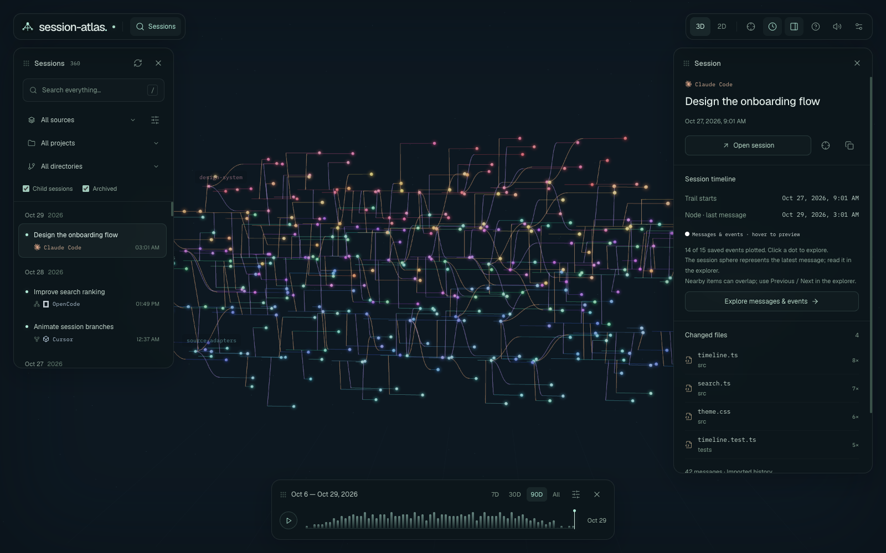

<h1 align="center">Session Atlas</h1>
<p align="center">Search &amp; visualize all your LLM sessions</p>
<p align="center">
  <a href="https://github.com/arvindell/session-atlas/releases/latest">Download</a> ·
  <a href="docs/guide.md">Documentation</a> ·
  <a href="docs/releases.md">Releases</a>
</p>



Explore **OpenCode, Claude Code, Codex, and Cursor** in one local-first app.
Search conversations, explore clickable messages and tool calls, inspect changed files, and continue in another harness.
Hover to preview messages, click to focus, and tune the glowing map, trails, and click sounds in Settings.
Importing, searching, and visualization stay on your computer.

### Install

Download a desktop app from [Releases](https://github.com/arvindell/session-atlas/releases/latest):

| macOS | Windows | Linux |
| --- | --- | --- |
| Apple Silicon / Intel · `.dmg` | x64 · `.exe`, `.msi` | x64 / ARM64 · `.deb`, `.rpm`, `.AppImage` |

Or launch with **Node.js 24+**:

```sh
npx @arvindell/session-atlas
npx @arvindell/session-atlas --browser
```

Private preview: GitHub and npm access are required. Run `npm login` first.

### Develop

```sh
pnpm install
pnpm dev
```

`pnpm desktop:dev` runs the native app. `pnpm test` runs the tests.
See the [guide](docs/guide.md) for source coverage, shortcuts, storage, and building locally.
